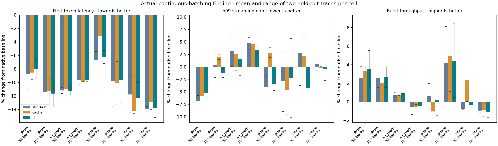

# Native cache scheduling and actual-engine RL

The ranking-only pilot is complete and independently replayed. Its cache-aware
policy improves average first-token latency against baseline in these controlled
workloads, but most benefit also appears with shortest-prefill ordering. The
learned actor mostly recovers that fixed policy; it does not establish an
additional general scheduler speedup.

The cold-prefix coalescing follow-up is a separate, stronger hypothesis with
fresh seeds and the baseline's built-in shortest-prefill control. Its remote
pipeline has been launched, but results have not yet been collected because
Safari stopped exposing the authorized notebook window. No coalescing result
or second trained-policy performance is claimed here.

## What changed

The first policy operates inside native continuous batching. It orders prefills
using actual matched prefix tokens, incremental private/retained block charges
and queued siblings sharing a cached prefix. Decodes retain priority, the normal
token budget remains unchanged, and the original allocator validates admissions.
An age override gives long-waiting queued requests precedence after64 planning
opportunities; it is not a wall-clock completion guarantee.

A linear softmax actor then samples FIFO, shortest-prefill or cache-aware
ordering inside C++ Engine steps. Actual GPU episodes produce the reward.
Six REINFORCE updates use24 episodes; parameters freeze before held-out testing.
This is real policy-gradient RL, not a classifier or timing-model optimizer.

## Collected measurements

-124 GPU jobs:28 fixed-policy/control,8 training references,24 RL episodes,
  and64 held-out evaluations. Every job offered64 requests in three short bursts.
-7,936 requests offered and complete.4,352 complete paired output comparisons
  match; no observed prefix mismatches.
-1,808 sampled native decisions have probabilities matching the pre-update
  actor weights. Reconstructing all measured rewards and all six updates
  reproduces the saved weights and final actor.
- Full native Engine suite:927 passed,1 skipped,4 disabled.48 focused tests pass.



Across the eight family/capacity cells, means of the two held-out traces show:

| Policy | Mean TTFT change vs native baseline across cells | Additional gain over shortest |
|---|---|---|
| Cache-aware ranking | -3.2% to -14.2% | No consistent advantage |
| Frozen RL actor | -6.2% to -13.7% | Mostly matches shortest |

These are ranges of cell means, not confidence intervals or a population-wide
gain. Native baseline is the unchanged source3d0d6eb build. The first pilot's
shortest control runs through the research helper and includes its age rule;
the coalescing follow-up strengthens that control to the existing baseline
implementation with its ordinary zero aging.

## Costs and interpretation

Some cells have worse p99 streaming gaps and lower burst throughput. Twenty-two
per-trace/control metric comparisons flag a latency cost above2%; the full list
and absolute metrics are retained. Native A/A diagnostics themselves vary by
several percent, so the2% flag is descriptive, not a confidence-bounded finding.

Individual requests can lose substantially even when the mean improves: the
largest matched TTFT delay is about1.31seconds for cache-aware ranking and
1.30seconds for RL. This is a material consequence of reordering, not merely
a percentile accounting artifact. No individual-latency dominance is established.

On the recorded training states, the frozen actor would select shortest on
1798/1808 states and the cache-aware action on10. This is a diagnostic over
training states, not a direct count of its held-out actions or changed GPU work.

All requests finish within the6-second observation, so completed/horizon is
the same across arms. The reported burst throughput instead uses64 divided by
final completion time. It must not be described as sustainable arrival capacity.

These small controlled workloads, two held-out seeds per cell and one L4/Qwen
configuration do not justify default enablement or show that RL is exhausted.
The original private KV-cap PR is unchanged.

## Follow-up and reproduction

The coalescing change defers only unallocated followers sharing an exact cold
prefix while one leader makes that prefix reusable. It keeps active requests
and unrelated work eligible. This can avoid repeated compute/KV allocation;
reduced parallelism and follower delay remain potential costs to measure.
See [COALESCE_PLAN.md](cache_rl/COALESCE_PLAN.md), including new train/test seeds.

For the completed pilot:

```bash
.venv/bin/python -m cache_rl.analyze results/cache-rl-native-v1
.venv/bin/python -m cache_rl.replay results/cache-rl-native-v1
.venv/bin/python -m cache_rl.plot results/cache-rl-native-v1
.venv/bin/python -m pytest -q
```

Raw results, actor logs, returns, weight checkpoints, executed source snapshot,
native overlay and Engine XML are retained. Independent validation instructions
are in [VALIDATE_CACHE_RL.md](VALIDATE_CACHE_RL.md). Pending collection details
are recorded in cache_rl/STATUS.md; do not substitute the plan for evidence.
