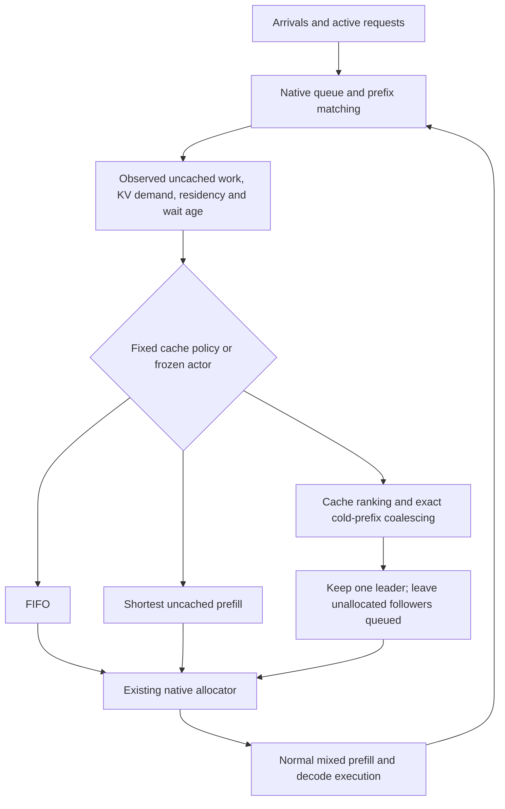
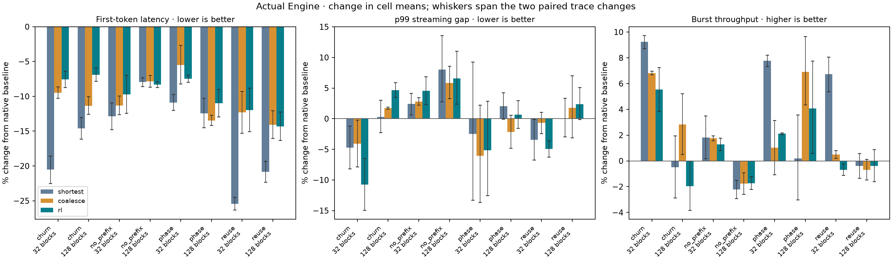
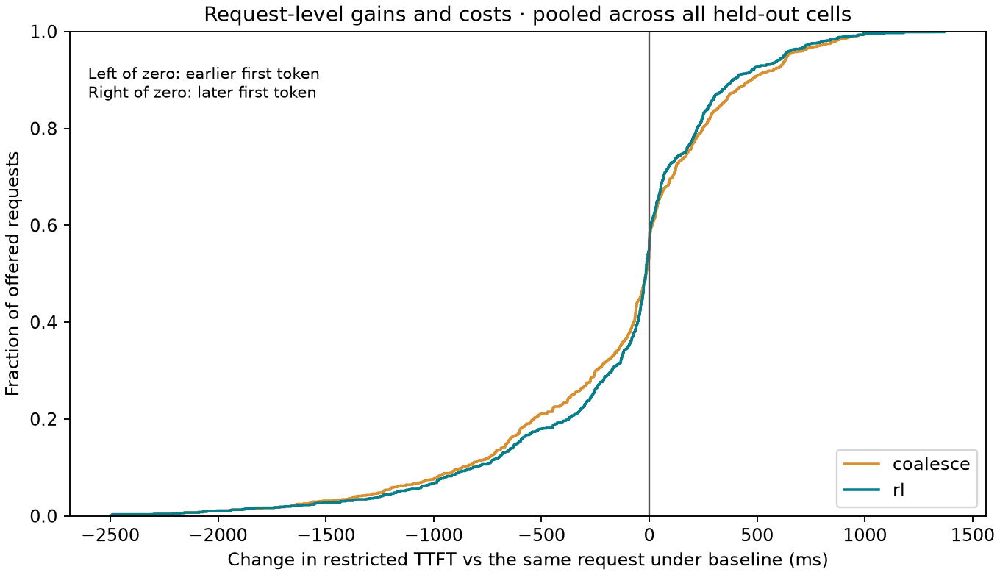

# Native cache scheduling and actual-engine RL

Cache-aware coalescing and the trained actor improve average first-token latency
against the normal native baseline in this experiment. **They do not qualify
for general enablement:** longer prompts lose on average, some streams have
larger gaps, and the existing shortest-prefill policy usually has lower mean
TTFT than either new policy.

## Background / context

LLM requests consume compute while reading a prompt, then repeatedly use KV
memory while generating output. Requests sharing a prompt prefix can reuse its
stored KV, but a scheduler can admit duplicates before that prefix is reusable.
The experiment asks whether considering this shared work improves scheduling
inside the real Engine, then whether RL learns a better decision rule.

## What the code changes

The fixed policy ranks prefills using uncached prompt tokens, marginal KV-block
charges and queued prefix reuse. It also compares the first 512 tokens exactly:
for a shared cold prefix, one leader proceeds while its unallocated followers
wait for reusable KV. Active requests, decodes and unrelated work stay eligible;
the existing allocator still decides what fits, with the normal token budget.

The RL version chooses FIFO, shortest-uncached-prefill or that cache/coalescing
policy from the current queue and cache state. A small linear actor samples
decisions inside native C++ scheduling steps; 24 actual GPU episodes supply
rewards for six REINFORCE updates. Its weights freeze before held-out runs.



Decodes retain priority. A 64-planning-opportunity override gives waiting
requests precedence, but does not guarantee wall-clock latency. This prototype
uses research-only environment switches; the original private KV-cap PR is
unchanged. There is no external cohort barrier or lower prefill budget here.

## Held-out results versus normal baseline code

One NVIDIA L4, public Qwen2.5-0.5B-Instruct INT4, 16 rows and a 2,048-token step
budget. Each trace offers 64 requests in three short bursts, with 1,537- or
769-token prompts and 32 forced output tokens. The observation ends at six
seconds without a drain. Baseline code is pinned to
`3d0d6eb1327a959c54f2a41f6741ab9414e50286` under these same settings.

KV capacity is simply available cache space: 32 blocks hold 8,192 token
positions; 128 hold 32,768, with 256 tokens per block. `reuse` favors warmed
prefixes, `churn` rotates prefix groups, `phase` switches from warm to cold
groups, and `no_prefix` has no shared prefix. These are controlled workloads,
not a representative sample of all serving traffic.

Means over two fresh held-out traces per cell follow. Parentheses show the
change from that cell's baseline mean. Lower TTFT is better; higher burst
throughput is better.

| Workload | KV blocks | Baseline TTFT, ms | Coalescing TTFT, ms | RL TTFT, ms | Coalescing burst throughput | RL burst throughput |
|---|---:|---:|---:|---:|---:|---:|
| churn | 32 | 1405.2 | 1271.9 (-9.5%) | 1298.6 (-7.6%) | +6.8% | +5.5% |
| churn | 128 | 1085.8 | 962.7 (-11.3%) | 1010.9 (-6.9%) | +2.8% | -2.0% |
| no_prefix | 32 | 2048.3 | 1816.9 (-11.3%) | 1849.0 (-9.7%) | +1.8% | +1.3% |
| no_prefix | 128 | 1554.8 | 1432.8 (-7.8%) | 1425.5 (-8.3%) | -1.8% | -1.7% |
| phase | 32 | 943.7 | 891.8 (-5.5%) | 873.4 (-7.5%) | +1.0% | +2.1% |
| phase | 128 | 816.6 | 706.6 (-13.5%) | 726.7 (-11.0%) | +6.9% | +4.1% |
| reuse | 32 | 1133.5 | 994.0 (-12.3%) | 997.9 (-12.0%) | +0.5% | -0.7% |
| reuse | 128 | 930.1 | 799.0 (-14.1%) | 797.0 (-14.3%) | -0.7% | -0.4% |



Bars compare every policy with normal baseline code. Whiskers span the two
paired trace changes; they are **not confidence intervals**. Burst throughput
means 64 divided by final completion time, not sustainable arrival capacity.
Completed requests per fixed horizon are identical because every request finishes.

## The tradeoff, including individual requests

The mean improves partly by moving short prompts ahead of longer prompts.
Across all 16 held-out traces, each policy has 672 longer-prompt and 352
shorter-prompt requests. Both classes generate the same 32 output tokens.

| Matched cost versus baseline | Coalescing | RL |
|---|---:|---:|
| Longer-prompt class: mean TTFT change | **77 ms later** | **97 ms later** |
| Shorter-prompt class: mean TTFT change | 526 ms earlier | 527 ms earlier |
| Largest individual TTFT delay | **1,323 ms** | **1,369 ms** |
| Largest individual completion delay | 1,461 ms | 1,509 ms |
| Requests whose first token is over 50 ms later | 349 / 1,024 (34.1%) | 339 / 1,024 (33.1%) |
| Worst cell-mean p99 streaming-gap change | +5.9% | +6.6% |
| Worst paired-trace p99 streaming-gap change | +8.5% | +11.0% |



The curve pools all offered held-out requests to expose both tails, not to
estimate a population distribution. Requests to the right of zero wait longer.
No first-token censoring occurs in these collected runs.

Six of 16 coalescing traces and nine of 16 RL traces have at least one aggregate
latency cost above 2% against normal baseline. Against the built-in shortest
control, the corresponding counts are 11 and 12. These are descriptive flags,
not statistical rejection tests. The predeclared qualification fails for both.

Hardware variation is material: the two native A/A diagnostics have TTFT changes
of +3.1% and +6.9%, and burst-throughput changes of -2.4% and -6.1%. The candidate
with its research policy disabled also varies. Two diagnostics do not bound
noise; small timing gains or costs need repeated randomized measurements.

## Does cache awareness or RL add something beyond shortest-prefill?

The stronger control uses the **baseline binary's existing
`cheapest_prefill_first` option**, with ordinary zero aging and no research
helper. It has lower mean TTFT in seven of eight cells against each new policy.
The `no_prefix` gains cannot be cache-reuse gains: they occur with zero cached
prompt tokens and largely reflect reordering.

There is a useful cache signal. For the 128-block phase workload, coalescing
raises mean reported cached prompt tokens from 49,792 to 54,272, while burst
throughput rises from 30.67 to 32.79 requests/s. Its TTFT is 706.6 ms versus
714.9 ms for built-in shortest. This is a promising point estimate in one cell,
not evidence of a general win. Other cases have unchanged or lower cache reuse.
The combined ranking/coalescing arm lacks a matched ranking-only ablation in
this second pilot, so individual components cannot receive causal credit.

RL does not establish an advantage over that existing control. Its frozen
actor would choose shortest on 1,745 of the 1,818 recorded training states and
coalescing on 73. This is a diagnostic on training states, not a count of held-out
actions or changed GPU allocations. A 24-episode, three-action linear actor
does not exhaust RL; the reward also lacks an explicit individual-latency penalty.

## What theory validates

If `q` queued requests share an aligned cold prefix of `L` tokens, one leader
computes it, publication succeeds, and the KV stays reusable, coalescing avoids
`(q - 1) * L` duplicate logical prefix tokens. With disjoint tails, shared
ownership similarly avoids `(q - 1) * L / block_size` physical prefix blocks.
These are conditional work/allocation identities. Less work can still mean
longer waits when batch parallelism falls or cache eviction changes the queue.

Neither these identities nor the earlier gated queueing theorem proves native
latency dominance. The contribution is a concrete queue/cache mechanism, an
actual-engine policy-gradient experiment, and a reproducible test of where
the theory transfers. Default enablement requires a stronger result.

## Short Q/A

**What is a streaming gap?** Time between successive delivered output tokens
for a request that has started generating. Here p99 pools observed token gaps
within a run; it excludes waiting for the first token and is not a request-level
end-to-end percentile.

**Why can average latency improve while many requests lose?** Serving short
prompts sooner saves a lot of waiting for those requests, while longer prompts
move back. The class table and request-level graph expose that redistribution.
Lower mean TTFT alone does not mean the whole serving system is uniformly faster.

**Could there still be a better learned policy?** Yes. This pilot trains a
three-action linear actor, with noisy terminal rewards and no individual-delay
penalty. It neither establishes RL optimality nor warrants a claim that a deeper
model would solve the tradeoff.

## Evidence and reproduction

The corrected repeat contains 124 GPU jobs: 28 development/control jobs, eight
training references, 24 training episodes and 64 held-out evaluations. All
7,936 offered requests finish; all 4,352 complete paired output comparisons
match. All 1,818 sampled native probabilities match pre-update parameters, and
replaying measured rewards reproduces all six updates and the frozen weights.
Native Engine tests: 927 passed, one skipped, four disabled; 48 focused tests pass.

The independent audit of the original project prompted shared harness repairs
before any repeat measurements. See [repair details](VALIDATION_REPAIRS.md).
Raw timestamps, failures, source snapshots, native overlay, weights and logs are
retained. The final archive includes both wheels and the baseline source archive;
measured library hashes match wheel contents. All 1,311 tracked source blobs
also match the pinned Git revision. This is verified build-record consistency,
not a hermetic rebuild or independent build attestation.

An earlier coalescing run's archives were lost when Colab expired before download;
its surviving completion/checksum record supplies no performance evidence. The
repeat kept policies and seeds unchanged while repairing validation. The first
ranking-only pilot remains under `results/cache-rl-native-v1`; its results are
preserved rather than replaced. Neither dataset supports general enablement.

```bash
.venv/bin/python -m cache_rl.analyze results/cache-coalesce-native-v1
.venv/bin/python -m cache_rl.replay results/cache-coalesce-native-v1
.venv/bin/python -m cache_rl.plot results/cache-coalesce-native-v1
.venv/bin/python -m pytest -q
```

For a stronger serving claim, freeze a policy and test repeated randomized
paired runs across sustained and burst arrivals, prompt/output lengths, reuse
and eviction pressure, cancellation/EOS, larger models and multiple GPU types.
Predeclare per-class and tail-latency costs as well as throughput, use fresh
holdouts, and retain failed/censored requests. The next optimization should
demonstrate an increment over existing shortest-prefill, not just normal FIFO.
The independent-agent prompt is [VALIDATE_CACHE_RL.md](VALIDATE_CACHE_RL.md).
