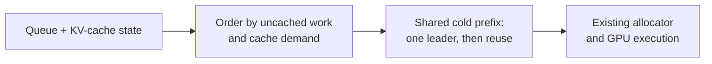

# Queueing networks for LLM scheduling

## Problem

An LLM server must share GPU compute and memory between incoming prompts and ongoing generation. Long prompts delay other requests; repeated prompt prefixes can duplicate work before their cached attention state (the KV cache) becomes reusable.

## Approach

We started from a pinned fork of Microsoft's open-source [ONNX Runtime GenAI](https://github.com/microsoft/onnxruntime-genai), rebuilt its native C++ scheduler, and tested changes inside the real Engine. All percentages use the frozen fork's normal configuration as baseline ([source snapshot](native/coalesce-source-manifest.json), `3d0d6eb`), with the same model, request traces and resource budgets.

Queueing models describe compute and KV-cache limits. The prototype orders requests by uncached work and cache demand, lets one request compute a shared cold prefix before its duplicates, and trains a small RL actor to choose between scheduling rules.

The cache-aware path below is one of the rules RL can select, alongside FIFO and shortest-prefill:

## Results

One L4 GPU, Qwen2.5-0.5B-Instruct INT4, two held-out traces per workload/capacity setting. Compared with normal repository code:

**Shorter prompts received their first token about 527 ms sooner (−45.4%)** across all held-out workloads. The corresponding longer-prompt cost is visible below:

| Mean first-token wait, all workloads | Baseline | Cache-aware | RL |
|---|---:|---:|---:|
| Shorter prompts (769 tokens) | 1,160 ms | **633 ms (−45.4%)** | **633 ms (−45.4%)** |
| Longer prompts (1,537 tokens) | 1,282 ms | 1,359 ms (+6.0%) | 1,379 ms (+7.6%) |

The strongest workload-specific gains follow. Peaks come from different workloads, not one simultaneous win; KV blocks measure available cache capacity. Burst throughput does not establish sustainable serving capacity.

| Best measured metric | Cache-aware | RL | Workload / KV blocks (cache-aware; RL) |
|---|---:|---:|---|
| Mean first-token latency | **−14.1%** | **−14.3%** | Prefix reuse / 128; same |
| Mean completion latency | **−10.9%** | **−11.4%** | Prefix reuse / 128; same |
| p99 pause between streamed tokens | **−6.0%** | **−10.8%** | Warm→cold / 32; cache churn / 32 |
| Burst throughput | **+6.9%** | **+5.5%** | Warm→cold / 128; cache churn / 32 |

**What worked:** request ordering reduced average latency; coalescing increased observed prefix reuse in some workloads. **RL did not establish an advantage over the fork's existing shortest-prefill option**, which beat each prototype on mean first-token latency in 7/8 cells.

**Tradeoff:** longer prompts waited **77 ms more (+6.0%)** with cache-aware scheduling and **97 ms more (+7.6%)** with RL on average. Individual delays reached 1.32/1.37 seconds; some streaming gaps worsened. Default enablement is not justified.

[Full results and graphs](CACHE_RL_REPORT.md) · [Theory](docs/THEORY.md) · [Reproduce](cache_rl/REPRODUCE.md) · [Validate](VALIDATE_CACHE_RL.md)
