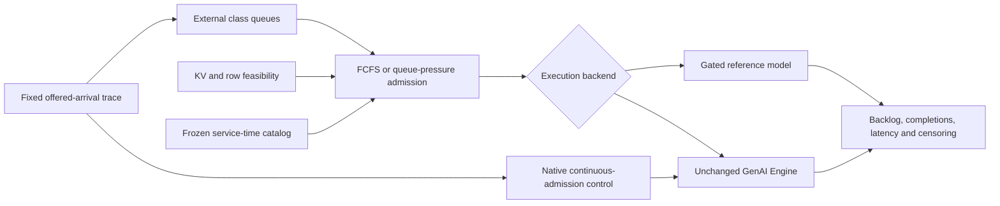

# Queueing networks for LLM scheduling

An executable research artifact connecting queueing models to Microsoft's
ONNX Runtime GenAI Engine. It asks: **how do finite batch and KV-cache limits
change the load a scheduling policy can sustain?**

The project contains an exact finite-action reference model, a queue-pressure
admission policy, an actual fork/join simulator, a real-engine offered-load
adapter, reproducible experiments and an adversarial validation handoff.
The original gated-model experiment changes no Microsoft source. A separate
research extension now tests native cache-aware scheduling and policy-gradient
RL; neither experiment establishes an always-on serving speedup.

## Native scheduling results

The cache-aware policy prioritizes uncached work and KV demand, letting one
request compute a shared cold prefix before admitting its duplicates. The RL
pilot learns when to choose FIFO, shortest-prefill or this cache-aware policy
inside the native scheduler; the normal prefill budget stays unchanged.

**Best measured results versus normal repository code** follow. Each entry is
the mean of two held-out traces; peaks come from the named workloads and do
not all occur together. Latency reductions are better; throughput increases
are better. KV blocks measure available cache capacity.

| Metric | Cache-aware scheduling | RL scheduling |
|---|---|---|
| Mean time to first token (TTFT) | 930.1 → **799.0 ms (−14.1%)**, prefix reuse / 128 blocks | 930.1 → **797.0 ms (−14.3%)**, prefix reuse / 128 blocks |
| Mean completion latency | 1,389.5 → **1,237.8 ms (−10.9%)**, prefix reuse / 128 blocks | 1,389.5 → **1,231.5 ms (−11.4%)**, prefix reuse / 128 blocks |
| p99 streaming gap (pause between output tokens) | 58.4 → **54.9 ms (−6.0%)**, warm→cold / 32 blocks | 62.4 → **55.7 ms (−10.8%)**, cache churn / 32 blocks |
| Burst throughput | 30.67 → **32.79 requests/s (+6.9%)**, warm→cold / 128 blocks | 19.95 → **21.05 requests/s (+5.5%)**, cache churn / 32 blocks |

**Shorter prompts see a larger benefit across all held-out workloads**, rather
than just the best cell: their mean TTFT drops from **1,160 to 633 ms (−45.4%)**
with either policy—about **527 ms earlier**. These are 769-token prompts;
longer prompts contain 1,537 tokens, and both generate 32 output tokens.

The tradeoff is real: longer prompts wait **77 ms more (+6.0%)** with cache-aware
scheduling and **97 ms more (+7.6%)** with RL on average. Individual first-token
delays reach 1.32 / 1.37 seconds, and some workloads have worse streaming gaps.
The existing shortest-prefill option beats each new policy on mean TTFT in
7/8 workload cells; these results demonstrate a research prototype, not an
RL advantage or a case for default enablement.

Measurements use one L4 GPU and Qwen2.5-0.5B-Instruct INT4, with two held-out
seeds per workload/capacity setting. Burst throughput is requests divided by
time to the final completion, not sustainable serving capacity; small changes
need more repetitions. See [all results, graphs and reproducible evidence](CACHE_RL_REPORT.md).

For the native extension, start with [the cache/RL report](CACHE_RL_REPORT.md),
[the frozen coalescing plan](cache_rl/COALESCE_PLAN.md), and
[independent validation instructions](VALIDATE_CACHE_RL.md). Its C++ overlays,
GPU evidence and training logs are separate from the original gated model.
The collected cache/coalescing and RL pilots are complete. Neither establishes
a generally better serving scheduler; the report includes per-class and
individual costs and the existing shortest-prefill control. See
[validation repairs](VALIDATION_REPAIRS.md) and
[hardware reproduction](cache_rl/REPRODUCE.md).
The root `MANIFEST.sha256` describes the current full artifact. The original
release manifest is preserved as `artifacts/MANIFEST-d147a49.sha256` and inside
the unchanged `llm-queueing-lab-d147a49.zip` beside this project.



## Run locally

Python3.11+. The model, capacity solver and simulations need only the standard
library. Plotting needs matplotlib; tests need pytest. No model download or GPU
is needed for the synthetic artifact.

```bash
python3 -m venv .venv
.venv/bin/pip install -e '.[plots,test]'
.venv/bin/python -m pytest -q
.venv/bin/python -m queueing_lab capacity
.venv/bin/python -m queueing_lab screen --output results/my-screen --horizon 30
.venv/bin/python -m queueing_lab report results/my-screen
```

Every screen output directory must be new; rerunning cannot silently overwrite
an existing result. The default screen is 360 single-station and 45 network runs.
See [the complete generated report](results/screen-v2/REPORT.md),
[mathematical derivation](docs/THEORY.md), [evaluation protocol](docs/EVALUATION.md)
and [research conclusions](REPORT.md).

## What changes in the policy

FCFS takes the oldest waiting requests that fit the remaining capacity. Pressure
enumerates feasible class-count vectors and chooses the largest
`sum(queue_length[class] * admitted_count[class]) / expected_cohort_duration`.
The denominator matters: a large batch can hold the server much longer. Within
each class, request order remains FIFO. Neither policy waits to fill a batch.

The reference model admits a whole cohort, prefills it, decodes it, then admits
the next cohort. The pressure rule is throughput-optimal **within this restricted
model** under the assumptions in THEORY.md. It does not guarantee lower TTFT,
better streaming gaps, or no individual regressions. A full-context reservation
avoids simulated admission deadlocks but can leave real hardware underused.

The hardware adapter uses the same external cohort admission rule, with actual
cohort times calibrated on the Engine. Internal inference remains Microsoft's
ordinary mixed-batch scheduler. The native arm bypasses this external gating;
it is the essential control for whether the proposal improves the real system.

## Real-engine reproduction

Requires a GPU-compatible GenAI build exposing `Engine`, `RequestOptions` and
`TurnOptions`, plus a paged Engine model export. This repository does not bundle
a model, Microsoft binary or credentials. The completed hardware run records
the precise package, model, loaded-library and configuration identities.

```bash
python -m queueing_lab hardware-config /tmp/queueing-config.json
python -m queueing_lab calibrate --config /tmp/queueing-config.json \
  --model /path/to/paged-model --output /tmp/service-table.json --reps 3
python -m queueing_lab hardware --model /path/to/paged-model \
  --table /tmp/service-table.json --policy native --rate 10 \
  --seed 20261101 --horizon 20 --output /tmp/native.json
python -m queueing_lab hardware --model /path/to/paged-model \
  --table /tmp/service-table.json --policy pressure --rate 10 \
  --seed 20261101 --horizon 20 --output /tmp/pressure.json
```

Change output paths between runs. Do not reuse a calibration after changing
the model/binary/config: the adapter checks those identities. See
`scripts/gpu_batch.py` for the complete 24-job protocol against the already
authorized Colab artifacts. Its `/content` paths are specific to that runtime;
the CLI above accepts arbitrary model/calibration/output paths.

Rebuild the actual-engine report with `python -m queueing_lab hardware-report
results/hardware-v1`. Run the extra 36 horizon/calibration-error checks with
`PYTHONPATH=. python scripts/stress_model.py --output results/my-stress`.
The walkthrough notebook is [notebooks/reproduce.ipynb](notebooks/reproduce.ipynb).

## Relation to the earlier KV-cap PR

The original cap work remains intact in the separate private Microsoft fork.
Its GPU results demonstrated meaningful benefits and real individual latency
costs; it remains opt-in. This project investigates capacity and policy design
instead of recasting those results as a universal improvement. It does not
replace the cap with unrelated planner CPU work.

## File map

| File | Purpose |
|---|---|
| `model.py` | KV feasibility, token timing, service catalog, exact two-class capacity |
| `policies.py` | FCFS, pressure, experimental network backpressure |
| `simulator.py` | Single-server offered-load simulation |
| `network.py` | Distinct servers, routing, fork/join synchronization |
| `runtime.py` | Shared wall-clock arrival coordinator and event accounting |
| `hardware.py` | Actual GenAI requests, calibration and identity checks |
| `experiments.py`, `report.py` | Frozen paired experiment plan and all-cell figures |
| `tests/` | Hand-derived cases, exhaustive properties, adversarial coordinator tests |
| `VALIDATE.md` | Instructions for an independent agent to attack the project |

Sources: [Dai et al., Throughput-Optimal Scheduling Algorithms for LLM Inference
and AI Agents](https://arxiv.org/html/2504.07347v3), and
[Dai and Lin, Maximum Pressure Policies](https://www.isye.gatech.edu/~dai/publications/daiLin05.pdf).
The finite gated proposition is stated separately; no new theorem or coauthorship
is attributed to these authors by this project.
