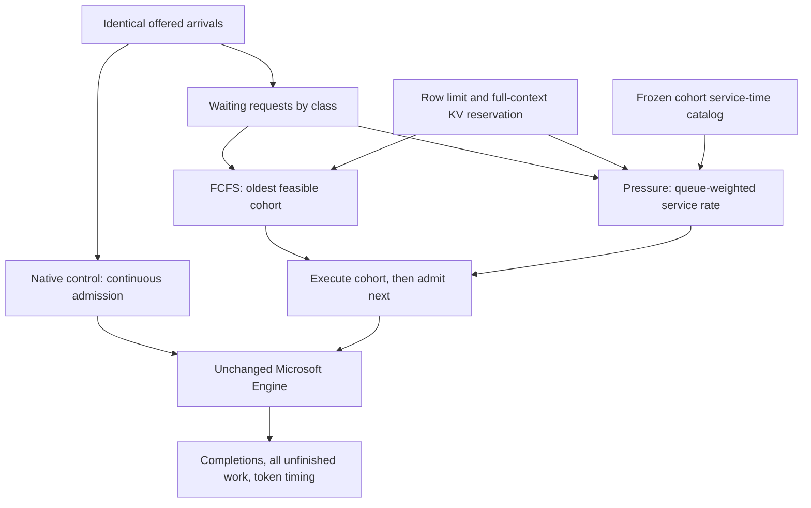
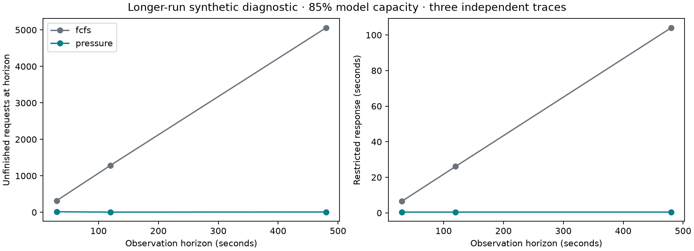

# Research result: queueing-aware admission with finite capacity

**The project validates a useful application of queueing theory, not a generally
faster replacement for Microsoft's scheduler.** The pressure policy stabilizes
the stated gated reference model throughout its strict capacity-region interior.
The actual Engine experiments show why transferring that result to continuous
batching requires care: pressure improves gated FCFS, but adds substantial
first-token delay relative to ordinary native admission at lighter loads.

## Background and the code change

LLM requests compete for both GPU processing and the KV memory that retains
their context. A scheduler can keep doing work yet choose batches whose service
times and class mix cannot keep up with incoming requests. This project turns
that queueing question into executable models and actual-engine experiments.

The intervention is **external cohort admission**. Instead of always taking
the oldest feasible waiting requests, pressure chooses a feasible class-count
vector maximizing `queue-weighted admitted requests / expected cohort duration`.
Each cohort reserves its declared maximum context and drains before the next
one enters. Within each class, requests stay FIFO. No future arrivals are used.

The reference model has a prefill barrier followed by shrinking decode batches.
The hardware adapter uses the actual Engine internally, so it can have different
service times and mixed prefill/decode behavior. This distinction is deliberate
and tested; the reference model is not described as a replica of GenAI.

## What the theory establishes

The feasible cohort set is finite. Its rate vectors define an exact gated
capacity region; a two-class solver returns an explicit action/time-fraction
certificate. A queue-pressure drift argument establishes stability strictly
inside that region under independent Poisson arrivals, known deterministic
class service times, monotone cohort durations and full-context reservation.

For the default two-class model, equal-mixture sustainable arrival capacity is
**28.822 requests/s**. Its witness time-shares cohorts of eight decode-heavy
requests and two prefill-heavy requests. This is a capacity result for that
restricted service family, not a claim about native Engine capacity.

The proof, assumptions, unavailable-class truncation argument and network limits
are in [THEORY.md](docs/THEORY.md). This is a standard pressure-control
construction applied to an explicit model; it is not claimed as a new theorem
by Dai or an independently peer-reviewed mathematical result.

## Synthetic results

The main screen has **360 single-server runs and 45 fork/join network runs**.
It includes three capacity configurations, Poisson/bursty/phase-changing
arrivals, five independent traces and loads below/above the model's sustainable
equal-mixture rate. All cells and censored requests are retained.

Preselected default configuration, Poisson arrivals at 85% model capacity;
means across five traces, 30-second observation:

| Metric | Gated FCFS | Pressure | Change |
|---|---:|---:|---:|
| Completed requests/s | 13.89 | 24.77 | +78.4% |
| Restricted mean response | 6.933 s | 0.452 s | -93.5% |
| Unfinished at horizon | 338.6 | 12.0 | -96.5% |

These large gains arise because this FCFS cohort mix is below the offered
workload's required service rate. Pressure chooses a more efficient service
mix, preventing the same accumulation. This is not a prediction that the
current Microsoft scheduler has the same defect.

An additional **36 stress runs** use three fresh seeds, horizons of 30/120/480
seconds, and prefill/decode cost-estimation errors by factors of 0.5/1/2. At
480 seconds and 85% model capacity, FCFS averages 5,059 unfinished requests;
pressure averages 8. The longer-run pressure response stays about 0.46 seconds
instead of growing to FCFS's 104 seconds. These are finite-run diagnostics;
the mathematical argument, not a flat-looking plot, supplies the model guarantee.

**Synthetic costs remain:** one of 180 paired traces has more than 2% worse
restricted response/TTFT; 33 have more than 2% worse observed p99 streaming gap.
The largest restricted-response cost is +5.4% under a changing class mix. The
policy does not establish bounded individual overtaking or latency dominance.
See [all cells](results/screen-v2/REPORT.md) and the per-class fairness figure.

The network simulator executes `0 -> {1,2} -> 3` on distinct simulated servers,
with one join per root job. Its 45 runs retain root outcomes, task admissions,
scheduled completion times, ready/active queues and blocked joins. Local
pressure/backpressure results are experimental; the single-server proof is
not extended to this network without further analysis.

## Actual Microsoft Engine results

**24 actual GPU jobs**, Qwen2.5-0.5B-Instruct INT4 on one NVIDIA L4, unchanged
baseline Engine build, four rows and sixteen KV blocks. Every action is first
calibrated on hardware. Each measured job uses a fresh process and a 12-second
offered-arrival trace; there are two traces per load and randomized native,
native A/A, gated FCFS and pressure arms.

The baseline source is `3d0d6eb1327a959c54f2a41f6741ab9414e50286`.
Every measured GenAI library matches the corresponding file inside the built
baseline wheel byte-for-byte; its SHA256 and build metadata are retained in
`baseline-build-provenance.json` beside the calibration.

The following are means of the two traces. Rate scales refer to the empirical
**gated** service catalog, not native continuous-batching capacity.

| Offered rate | Policy | Completed/s | Restricted response | Restricted TTFT |
|---:|---|---:|---:|---:|
| 9.98 req/s | Native continuous admission | 8.833 | 195.5 ms | 20.5 ms |
| 9.98 req/s | Gated FCFS | 8.625 | 315.8 ms | 158.6 ms |
| 9.98 req/s | Pressure | 8.750 | 301.4 ms | 147.7 ms |
| 16.96 req/s | Native continuous admission | 14.583 | 270.3 ms | 80.7 ms |
| 16.96 req/s | Gated FCFS | 13.292 | 993.2 ms | 847.7 ms |
| 16.96 req/s | Pressure | 14.458 | 371.5 ms | 213.6 ms |
| 20.96 req/s | Native continuous admission | 17.083 | 635.4 ms | 453.5 ms |
| 20.96 req/s | Gated FCFS | 13.542 | 1,848.8 ms | 1,731.9 ms |
| 20.96 req/s | Pressure | 17.542 | 632.8 ms | 480.1 ms |

At the middle load, pressure improves gated FCFS throughput by 8.8% and
restricted response by 62.6%. **Against native admission, it instead has
37.4% worse restricted response and 164.5% worse restricted TTFT**, using ratios
of the displayed means. At the light load its TTFT is about seven times native.

At the highest load, pressure completes about 2.7% more requests than native,
but the average hides important variation: its two paired response changes
are **-8.2% and +17.0%**, and TTFT changes are **-6.7% and +49.5%**. This is
insufficient evidence of a reliable native-engine improvement.

Observed p99 streaming gaps fall from roughly 19–21 ms in the native arm to
4–4.5 ms in pressure cohorts. This has an understandable cost: external gating
moves waiting ahead of admission/first token and reduces prefill interruptions
once a cohort is streaming. It does not remove waiting from the system.

Across all measured jobs: **4,176 offered requests, 3,771 complete and 405
unfinished at the observation boundary**. No Engine job failed. All 2,783
complete paired output comparisons match; partial observed output prefixes
also match. Native A/A response differences range from -3.3% to +3.4%, and
restricted-TTFT differences from -7.1% to +4.3%. Those are small controls, not
confidence bounds.

The [hardware report](results/hardware-v1/REPORT.md) contains all four arms;
`analysis.json` retains every seed, class-level metric and raw-file hash.
Model/binary/config/prompt identities and loaded GenAI library paths are checked.
A CUDA library-path setup failure occurred before measured jobs began and is
preserved in `setup-failure/`; it is not silently counted as a successful run.

## Evidence quality and reproduction

- 23 tests cover independent hand-derived timing/queue-area cases, exhaustive
  action checks, dense capacity mixtures, future-arrival isolation, join
  synchronization, live-coordinator errors and evidence-corruption rejection.
- An extracted pre-run source snapshot reproduced all 360 single-server and
  45 network metric summaries exactly. The stress run has its own source snapshot.
- The package installs in an isolated environment and builds a wheel. All
  walkthrough notebook code cells execute. CI definitions cover Python 3.11/3.13;
  hosted CI has not run because this project has not been pushed.
- The actual GPU source is preserved under `results/hardware-v1/source/` and
  matches its pre-run hashes. It predates the extra restricted-TTFT reporting
  field; that field is derived locally from its immutable raw token times.

Reproduce using [README.md](README.md). An independent agent should follow
[VALIDATE.md](VALIDATE.md), including an independent mathematical derivation.
The experiments are narrow controlled workloads with fixed class lengths and
generation caps; they do not cover arbitrary real serving distributions,
unknown early EOS, prefix reuse, cancellation, speculation or multiple GPUs.

## What to contribute

The strongest immediate open-source candidate is the offered-load benchmark,
which reveals backlog and censored latency without changing the scheduler.
The pressure policy remains a research intervention. Integrating its objective
inside continuous batch formation, while preserving efficient admission and
cache semantics, is the next research question—not an established fix.

See [UPSTREAM.md](docs/UPSTREAM.md) for the small-contribution path. The original
private KV-cap PR remains unchanged and opt-in. This standalone project has not
been published or submitted to Microsoft.
