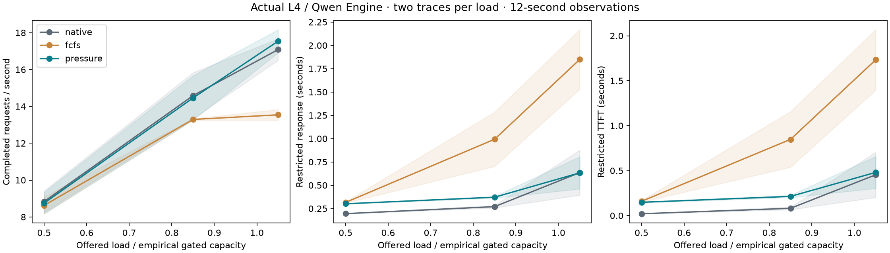

# Actual-engine diagnostic

24 short diagnostic jobs; no confidence-bounded non-regression or native-engine stability proof

The native arm uses ordinary continuous admission. Both other policies impose external cohort gating. All use the same unchanged baseline binary.

| Load scale | Arm | Completed/s | Unfinished | Restricted response, s | Restricted TTFT, s | Observed p99 gap, ms |
|---:|---|---:|---:|---:|---:|---:|
| 0.50 | fcfs | 8.625 | 4.0 | 0.3158 | 0.1586 | 4.21 |
| 0.50 | native | 8.833 | 1.5 | 0.1955 | 0.0205 | 19.40 |
| 0.50 | native_aa | 8.833 | 1.5 | 0.1963 | 0.0207 | 19.47 |
| 0.50 | pressure | 8.750 | 2.5 | 0.3014 | 0.1477 | 4.06 |
| 0.85 | fcfs | 13.292 | 22.0 | 0.9932 | 0.8477 | 4.55 |
| 0.85 | native | 14.583 | 6.5 | 0.2703 | 0.0807 | 20.31 |
| 0.85 | native_aa | 14.583 | 6.5 | 0.2646 | 0.0766 | 20.18 |
| 0.85 | pressure | 14.458 | 8.0 | 0.3715 | 0.2136 | 4.36 |
| 1.05 | fcfs | 13.542 | 70.5 | 1.8488 | 1.7319 | 4.49 |
| 1.05 | native | 17.083 | 28.0 | 0.6354 | 0.4535 | 20.59 |
| 1.05 | native_aa | 17.000 | 29.0 | 0.6520 | 0.4700 | 20.67 |
| 1.05 | pressure | 17.542 | 22.5 | 0.6328 | 0.4801 | 4.49 |

Offered across all jobs: 4176; completed: 3771; unfinished at the observation boundary: 405.
Failed jobs: 0. Complete matched output comparisons: 2783; mismatches: 0; partial-prefix mismatches: 0.
Empirical duration catalog monotone: True. This is not a hardware stability certificate.

## Limits

The rate scale is derived from measured gated cohorts, not the capacity of native continuous batching. Two traces and12seconds per job are a transfer diagnostic. Restricted latency includes censored requests but is not their eventual response time. Gap quantiles include observed gaps only. See every per-seed comparison, native A/A result, per-class metric and raw-file hash in analysis.json.

## Source provenance

The GPU bundle contains the exact executed Python source under source/. It predates the later restricted-TTFT reporting addition; this report derives that metric from the immutable token log. The pre-run source hashes, calibration, complete engine config and model/binary/prompt hashes are retained. A first setup-only attempt failed because its process omitted the previously validated CUDA library paths; no measured workload jobs had started. Its log is preserved separately.
