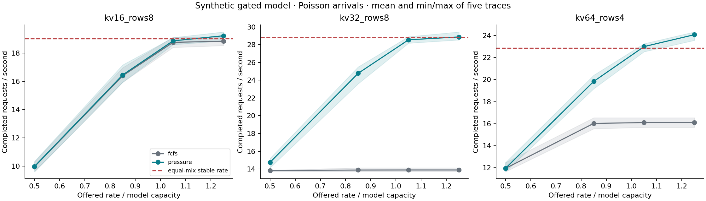
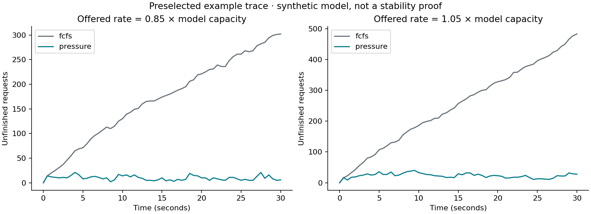
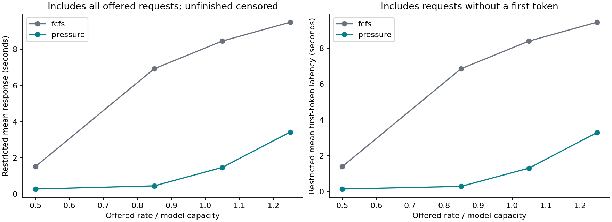
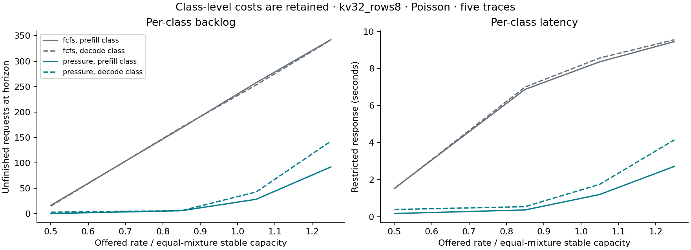

# Complete synthetic screen

These are model experiments, not ONNX Runtime GenAI speedup measurements.
All cells below are retained. Values average five independent arrival traces; no confidence claim.
Completion rates count only completions before the fixed horizon. Restricted response averages min(response, remaining observation time), including unfinished work.
The dashed line is the sustainable equal-mixture arrival rate. Under overload, departures can have a different class mix and finite-window total completion rate can exceed that line while one class accumulates backlog. It is not an upper bound on arbitrary transient total completions.

| Setting | Pattern | Load / capacity | Policy | Completed/s | Unfinished | Restricted response, s | Restricted TTFT, s | TTFT censored |
|---|---|---:|---|---:|---:|---:|---:|---:|
| kv16_rows8 | bursty | 0.50 | fcfs | 10.27 | 10.0 | 0.654 | 0.521 | 8.2 |
| kv16_rows8 | bursty | 0.50 | pressure | 10.31 | 8.6 | 0.600 | 0.467 | 6.8 |
| kv16_rows8 | bursty | 0.85 | fcfs | 16.25 | 42.6 | 1.620 | 1.490 | 39.0 |
| kv16_rows8 | bursty | 0.85 | pressure | 16.37 | 39.0 | 1.521 | 1.392 | 37.2 |
| kv16_rows8 | bursty | 1.05 | fcfs | 18.12 | 96.4 | 2.758 | 2.636 | 94.4 |
| kv16_rows8 | bursty | 1.05 | pressure | 18.34 | 89.8 | 2.580 | 2.461 | 89.2 |
| kv16_rows8 | bursty | 1.25 | fcfs | 18.67 | 202.0 | 4.257 | 4.151 | 198.0 |
| kv16_rows8 | bursty | 1.25 | pressure | 19.18 | 186.6 | 3.971 | 3.870 | 185.4 |
| kv16_rows8 | phase | 0.50 | fcfs | 9.91 | 4.0 | 0.245 | 0.114 | 1.8 |
| kv16_rows8 | phase | 0.50 | pressure | 9.91 | 4.0 | 0.237 | 0.106 | 1.8 |
| kv16_rows8 | phase | 0.85 | fcfs | 15.92 | 22.6 | 0.609 | 0.478 | 19.4 |
| kv16_rows8 | phase | 0.85 | pressure | 15.86 | 24.4 | 0.604 | 0.472 | 20.4 |
| kv16_rows8 | phase | 1.05 | fcfs | 17.97 | 79.4 | 1.311 | 1.199 | 75.4 |
| kv16_rows8 | phase | 1.05 | pressure | 17.87 | 82.4 | 1.162 | 1.045 | 78.4 |
| kv16_rows8 | phase | 1.25 | fcfs | 19.36 | 152.4 | 2.308 | 2.213 | 148.4 |
| kv16_rows8 | phase | 1.25 | pressure | 19.34 | 153.0 | 2.005 | 1.904 | 149.0 |
| kv16_rows8 | poisson | 0.50 | fcfs | 9.95 | 2.8 | 0.295 | 0.170 | 1.8 |
| kv16_rows8 | poisson | 0.50 | pressure | 9.97 | 2.2 | 0.254 | 0.128 | 1.2 |
| kv16_rows8 | poisson | 0.85 | fcfs | 16.39 | 8.4 | 0.498 | 0.362 | 6.0 |
| kv16_rows8 | poisson | 0.85 | pressure | 16.45 | 6.6 | 0.409 | 0.272 | 4.0 |
| kv16_rows8 | poisson | 1.05 | fcfs | 18.76 | 55.6 | 1.692 | 1.562 | 54.6 |
| kv16_rows8 | poisson | 1.05 | pressure | 18.87 | 52.4 | 1.557 | 1.428 | 50.4 |
| kv16_rows8 | poisson | 1.25 | fcfs | 18.84 | 168.0 | 3.680 | 3.569 | 164.6 |
| kv16_rows8 | poisson | 1.25 | pressure | 19.23 | 156.4 | 3.426 | 3.320 | 154.4 |
| kv32_rows8 | bursty | 0.50 | fcfs | 13.21 | 73.6 | 2.830 | 2.715 | 71.0 |
| kv32_rows8 | bursty | 0.50 | pressure | 15.63 | 1.0 | 0.507 | 0.343 | 0.0 |
| kv32_rows8 | bursty | 0.85 | fcfs | 13.79 | 358.4 | 7.481 | 7.408 | 356.4 |
| kv32_rows8 | bursty | 0.85 | pressure | 25.24 | 14.8 | 1.153 | 0.981 | 10.8 |
| kv32_rows8 | bursty | 1.05 | fcfs | 13.77 | 526.8 | 8.890 | 8.830 | 525.4 |
| kv32_rows8 | bursty | 1.05 | pressure | 27.66 | 110.2 | 2.375 | 2.220 | 106.6 |
| kv32_rows8 | bursty | 1.25 | fcfs | 13.78 | 692.6 | 9.949 | 9.899 | 691.2 |
| kv32_rows8 | bursty | 1.25 | pressure | 28.78 | 242.6 | 3.903 | 3.768 | 237.8 |
| kv32_rows8 | phase | 0.50 | fcfs | 14.68 | 5.4 | 0.277 | 0.136 | 2.2 |
| kv32_rows8 | phase | 0.50 | pressure | 14.70 | 4.8 | 0.255 | 0.113 | 1.8 |
| kv32_rows8 | phase | 0.85 | fcfs | 18.14 | 211.0 | 3.748 | 3.664 | 206.2 |
| kv32_rows8 | phase | 0.85 | pressure | 24.09 | 32.6 | 0.539 | 0.374 | 25.0 |
| kv32_rows8 | phase | 1.05 | fcfs | 15.34 | 467.4 | 6.904 | 6.867 | 464.8 |
| kv32_rows8 | phase | 1.05 | pressure | 27.06 | 115.8 | 1.172 | 1.022 | 107.8 |
| kv32_rows8 | phase | 1.25 | fcfs | 13.92 | 683.0 | 9.034 | 9.003 | 680.8 |
| kv32_rows8 | phase | 1.25 | pressure | 29.11 | 227.4 | 2.128 | 1.998 | 219.4 |
| kv32_rows8 | poisson | 0.50 | fcfs | 13.81 | 31.4 | 1.521 | 1.393 | 29.0 |
| kv32_rows8 | poisson | 0.50 | pressure | 14.75 | 3.4 | 0.279 | 0.145 | 2.4 |
| kv32_rows8 | poisson | 0.85 | fcfs | 13.89 | 338.6 | 6.933 | 6.857 | 337.2 |
| kv32_rows8 | poisson | 0.85 | pressure | 24.77 | 12.0 | 0.452 | 0.289 | 10.0 |
| kv32_rows8 | poisson | 1.05 | fcfs | 13.89 | 510.8 | 8.459 | 8.397 | 509.4 |
| kv32_rows8 | poisson | 1.05 | pressure | 28.55 | 71.2 | 1.473 | 1.309 | 65.6 |
| kv32_rows8 | poisson | 1.25 | fcfs | 13.89 | 683.8 | 9.501 | 9.449 | 682.4 |
| kv32_rows8 | poisson | 1.25 | pressure | 28.87 | 234.6 | 3.429 | 3.293 | 229.4 |
| kv64_rows4 | bursty | 0.50 | fcfs | 12.24 | 20.8 | 1.190 | 1.064 | 19.6 |
| kv64_rows4 | bursty | 0.50 | pressure | 12.67 | 7.8 | 0.501 | 0.362 | 5.6 |
| kv64_rows4 | bursty | 0.85 | fcfs | 15.78 | 144.6 | 4.016 | 3.912 | 141.6 |
| kv64_rows4 | bursty | 0.85 | pressure | 19.89 | 21.2 | 1.161 | 1.020 | 19.2 |
| kv64_rows4 | bursty | 1.05 | fcfs | 15.91 | 286.6 | 5.943 | 5.857 | 283.6 |
| kv64_rows4 | bursty | 1.05 | pressure | 22.60 | 86.0 | 2.130 | 2.004 | 82.0 |
| kv64_rows4 | bursty | 1.25 | fcfs | 16.04 | 406.8 | 7.342 | 7.268 | 404.0 |
| kv64_rows4 | bursty | 1.25 | pressure | 24.05 | 166.6 | 3.242 | 3.132 | 163.4 |
| kv64_rows4 | phase | 0.50 | fcfs | 11.87 | 4.0 | 0.266 | 0.130 | 0.8 |
| kv64_rows4 | phase | 0.50 | pressure | 11.87 | 4.0 | 0.255 | 0.119 | 1.2 |
| kv64_rows4 | phase | 0.85 | fcfs | 17.60 | 74.8 | 1.050 | 0.935 | 71.2 |
| kv64_rows4 | phase | 0.85 | pressure | 17.84 | 67.6 | 0.926 | 0.806 | 64.4 |
| kv64_rows4 | phase | 1.05 | fcfs | 19.68 | 151.4 | 1.815 | 1.718 | 147.6 |
| kv64_rows4 | phase | 1.05 | pressure | 19.98 | 142.4 | 1.513 | 1.408 | 139.2 |
| kv64_rows4 | phase | 1.25 | fcfs | 21.36 | 233.2 | 2.738 | 2.655 | 229.2 |
| kv64_rows4 | phase | 1.25 | pressure | 22.09 | 211.4 | 1.997 | 1.902 | 207.4 |
| kv64_rows4 | poisson | 0.50 | fcfs | 11.93 | 2.0 | 0.301 | 0.171 | 0.8 |
| kv64_rows4 | poisson | 0.50 | pressure | 11.94 | 1.8 | 0.257 | 0.126 | 1.0 |
| kv64_rows4 | poisson | 0.85 | fcfs | 16.02 | 122.2 | 3.202 | 3.093 | 121.0 |
| kv64_rows4 | poisson | 0.85 | pressure | 19.83 | 7.8 | 0.377 | 0.235 | 4.2 |
| kv64_rows4 | poisson | 1.05 | fcfs | 16.09 | 259.0 | 5.361 | 5.272 | 257.4 |
| kv64_rows4 | poisson | 1.05 | pressure | 23.00 | 51.8 | 1.268 | 1.134 | 48.6 |
| kv64_rows4 | poisson | 1.25 | fcfs | 16.09 | 391.2 | 6.931 | 6.855 | 389.6 |
| kv64_rows4 | poisson | 1.25 | pressure | 24.08 | 151.6 | 2.856 | 2.743 | 149.2 |

## Costs are retained

Across 180 paired traces, pressure worsens these point metrics by more than 2%: `{'restricted_mean_response_s': 1, 'restricted_mean_ttft_s': 1, 'observed_p99_gap_s': 33}`.
These counts are descriptive. Observed-only TTFT and gap metrics are not valid unconditional latency comparisons when censoring differs.

## Network evidence

`network.jsonl.gz` contains all fork/join task transitions, join buffers and root outcomes. `network-summary.json` retains every policy/seed/load.
The single-server theorem is not a proof of network stability or a hardware multi-GPU result.

## Reproduction

The frozen plan includes settings, seeds, horizon and source SHA256 hashes. `runs.jsonl.gz` retains every offered request and cohort; synthetic token paths can be reconstructed from config and cohort start/action. This compact file is not a full per-token event log.
